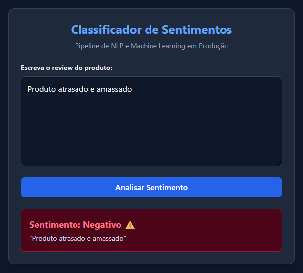
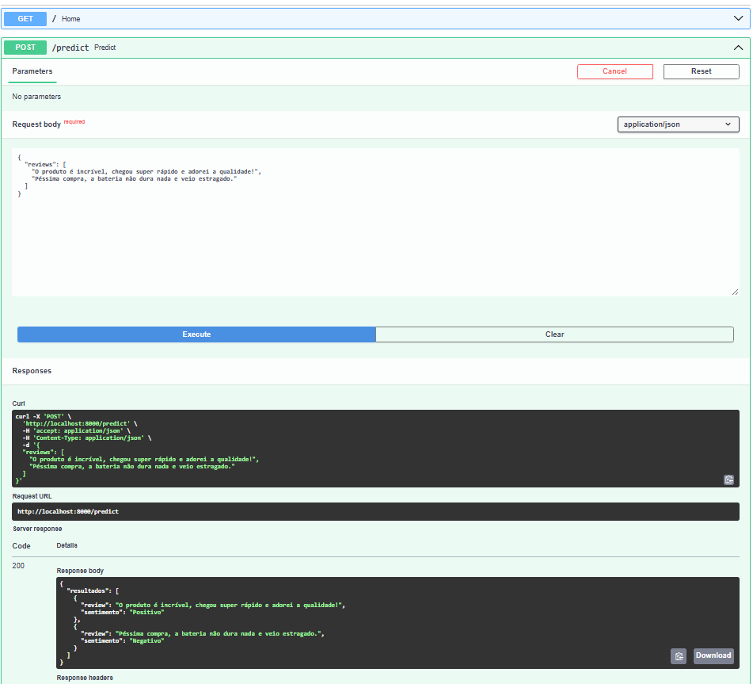

# Sentiment Analysis MLOps Pipeline

Pipeline de Machine Learning de ponta a ponta para classificação de sentimentos em reviews de e-commerce, estruturado com foco em engenharia de software, MLOps, conteinerização e deploy em nuvem.

O projeto transforma um modelo preditivo tradicional num serviço web completo, expondo previsões em tempo real através de uma API REST consumida por uma interface web moderna.

🔗 **Acede à Aplicação Online:** [Análise de Sentimentos - MLOps Case](https://sentiment-mlops.vercel.app/)

---

## 🚀 Arquitetura e Tecnologias

- **Modelagem & NLP:** Python, Pandas, Scikit-learn (Pipeline, TF-IDF Vectorizer, StandardScaler, Regressão Logística).
- **Backend / API:** FastAPI e Uvicorn (com suporte a CORS e portas dinâmicas).
- **Infraestrutura:** Docker (conteinerização do ambiente).
- **Deploy (Cloud):** 
  - **Backend:** Hospedado no [Render](https://render.com) (via contentor Docker).
  - **Frontend:** Interface web hospedada na [Vercel](https://vercel.com).

---

## 📂 Estrutura do Repositório

```text
sentiment-mlops/
├── app.py                         # API FastAPI para inferência em tempo real
├── Dockerfile                     # Configuração para empacotamento em contentor
├── requirements.txt               # Dependências do projeto
├── modelo_sentimento_dsa_v1.joblib # Artefato do modelo treinado (pipeline serializado)
├── index.html                     # Interface web estática (Frontend)
├── assets/                        # Imagens e documentação visual
└── README.md                      # Documentação do projeto
```

---

## 📊 O Modelo
- **Tarefa:** Classificação binária de texto (`Positivo` ou `Negativo`).
- **Pré-processamento:** Limpeza de texto personalizada (normalização de caracteres, remoção de acentos, pontuação e conversão para minúsculas) encapsulada diretamente no Pipeline do Scikit-learn para evitar *data leakage* e garantir consistência entre treino e produção.

---

## 🛠️ Como Executar Localmente via Docker

Certifica-te de que tens o **Docker** instalado e a correr no teu computador.

1. Clona o repositório:
   ```bash
   git clone https://github.com/calebsaldanha/sentiment-mlops.git
   cd sentiment-mlops
   ```

2. Constrói a imagem Docker:
   ```bash
   docker build -t sentiment-mlops .
   ```

3. Executa o contentor:
   ```bash
   docker run -p 8000:8000 sentiment-mlops
   ```

4. Acede à documentação interativa (Swagger UI) no navegador:
   - `http://localhost:8000/docs`

---

## 🌐 Endpoints da API

- `GET /` — Verifica o estado de funcionamento da API.
- `POST /predict` — Recebe um JSON com um array de textos e devolve a predição de sentimentos correspondente.

**Exemplo de Payload (`POST /predict`):**
```json
{
  "reviews": [
    "O produto chegou super rápido e a qualidade é excelente!",
    "Péssima compra, estragou no primeiro dia de uso."
  ]
}
```

---

## 💡 Demonstração Visual

### Interface Web (Frontend na Vercel)


### Documentação da API (Swagger UI)


---

## 👨‍💻 Autor
Desenvolvido por **Caleb Saldanha**.  
💼 [LinkedIn](https://www.linkedin.com/in/caleb-saldanha) | 🐙 [GitHub](https://github.com/calebsaldanha)
